# Flathead

A side-facing plug for Apple chargers. Simple, minimal, functional. The charger lies flat on the wall instead of
standing off it.

[](https://github.com/cpwillis-pocs/flathead/actions/workflows/ci.yml)
[](LICENSE)
[](LICENSE-APACHE)

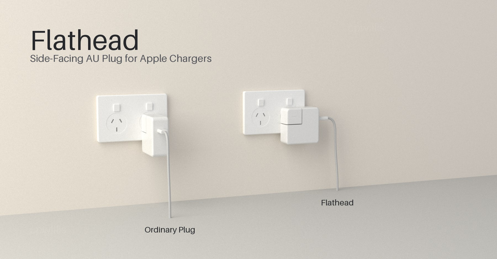

Proof of concept: idea to CAD to mould to boxed unit, done in-house, CAD as code
([build123d](https://github.com/gumyr/build123d)). Targets AS/NZS 3112 sockets.
**Not a certified product. Never use a prototype on live mains.**

| Out from the Outlet | Anatomy |
|---|---|
| 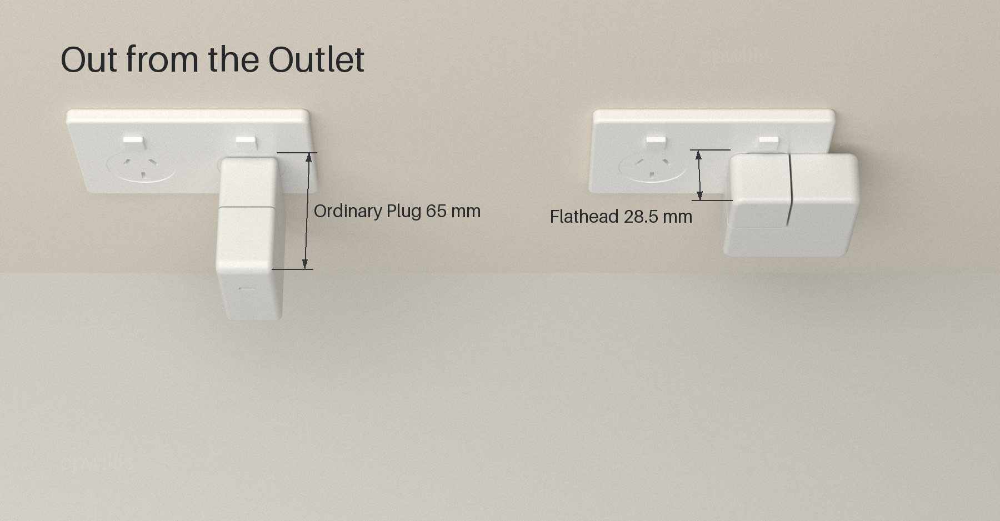 | 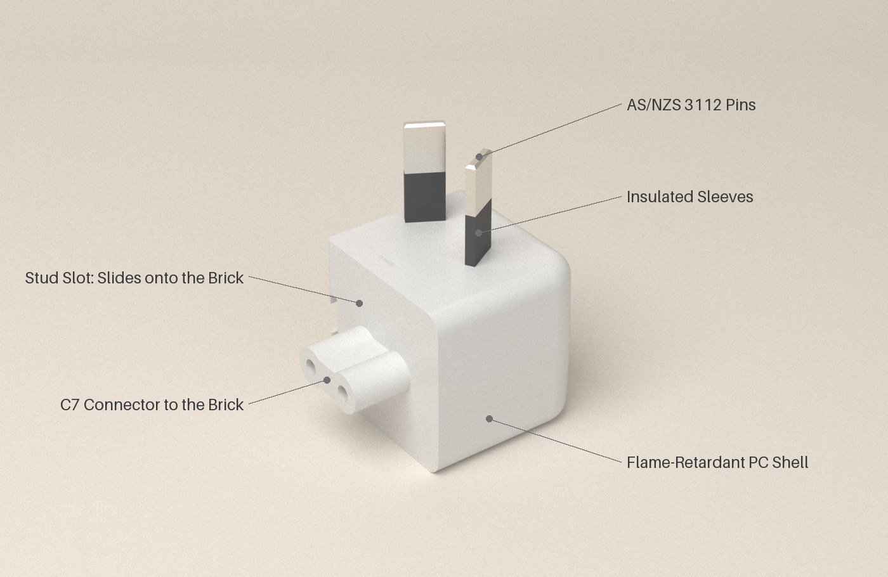 |

The plug replaces the brick's removable head and fills its corner notch, so brick and plug read as one slim block.
Both designs share that outline: plugged in, the fixed and folding versions look the same.

## Designs

| | **D1 Fixed Pins**: The Practical Design | **D2 Folding Pins**: The Eye-Catcher |
|---|---|---|
| Product | 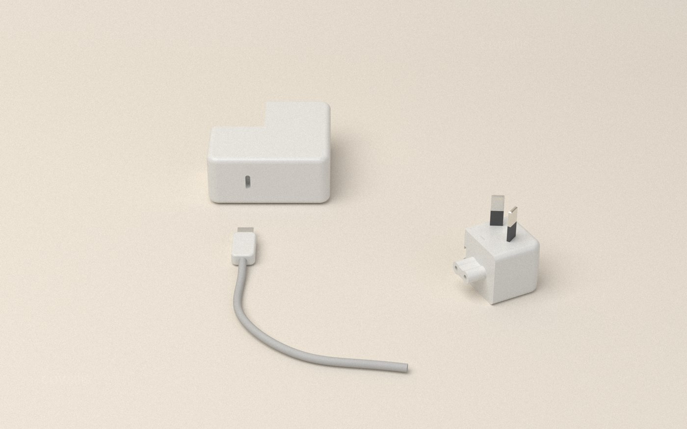 | 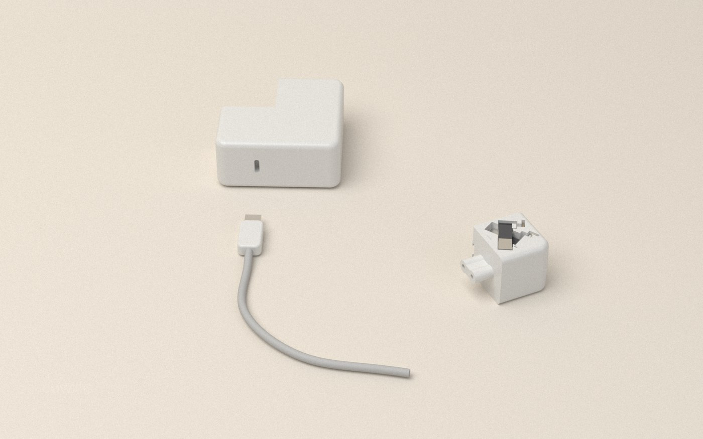 |
| What It Is | Pins insert moulded in the top shell; two welded FR PC shells. Every CAD design check passes, with tools and DFM (a design screen, not certification). | Each pin folds flat on its own hinge; the folded pins cross, active under neutral, flush with the face. Same envelope, shells and tooling approach as D1. Each pin disconnects within 10 deg of folding. AS/NZS 3112:2025 cl 2.13.9.1 requires fixed pins [7], so D2 stays a concept. |
| Plug Face |  |  |
| Head | 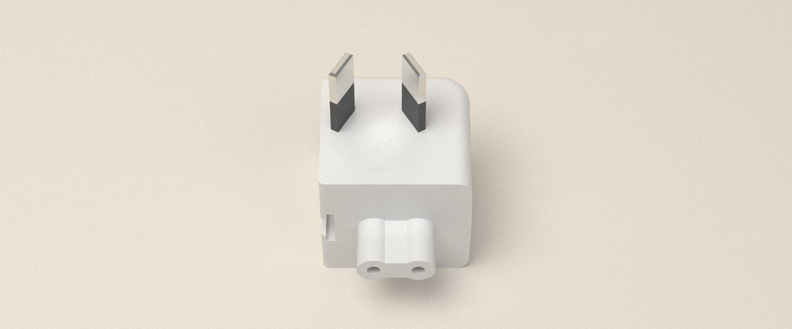 | 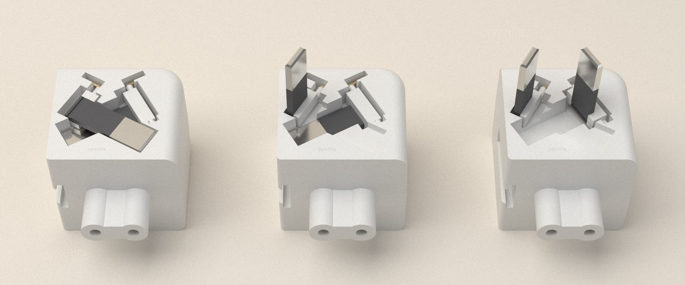 |
| On the Brick | 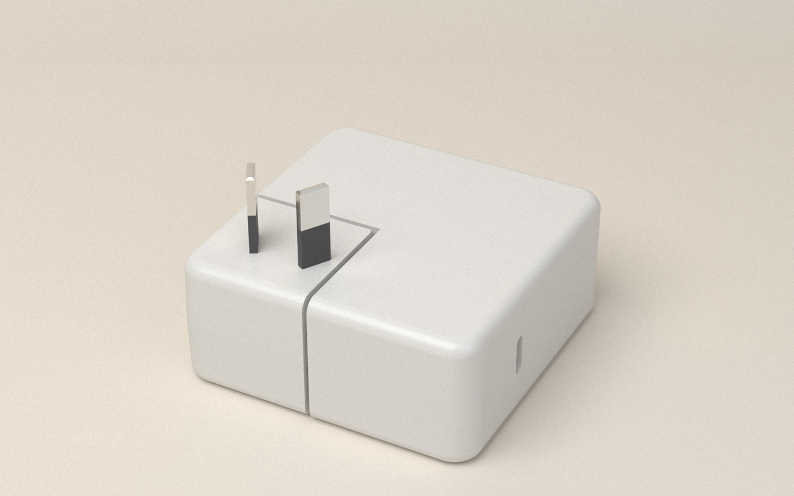 | 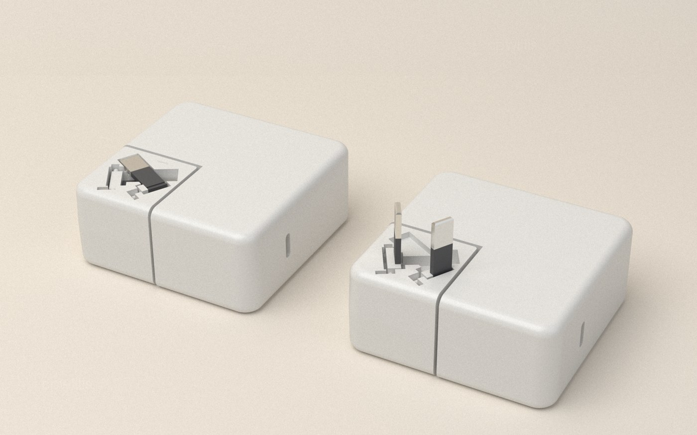 |
| Exploded | 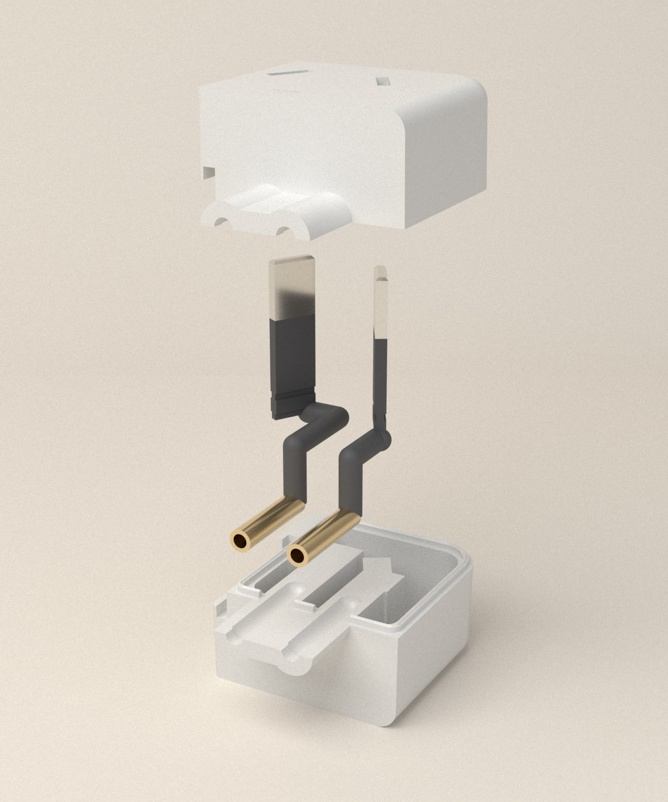 | 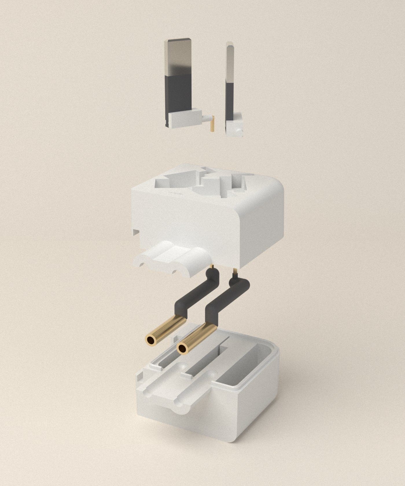 |
| Lead Frame | 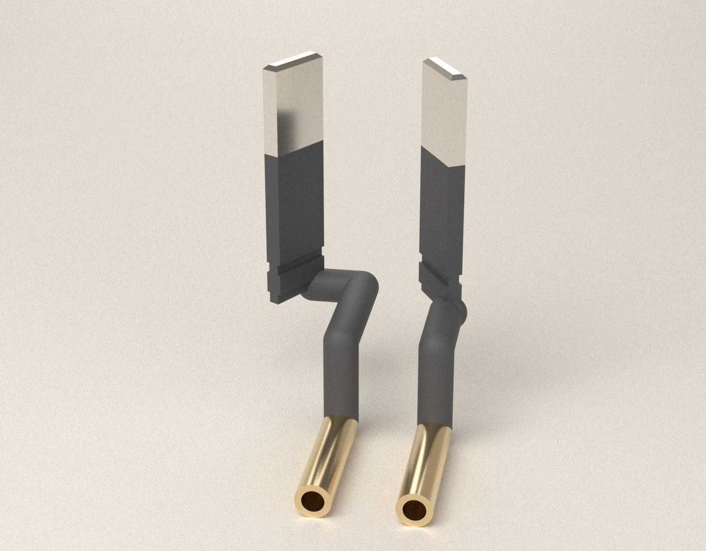 | 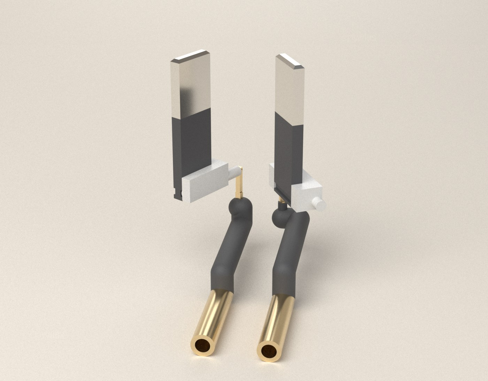 |
| Tooling | 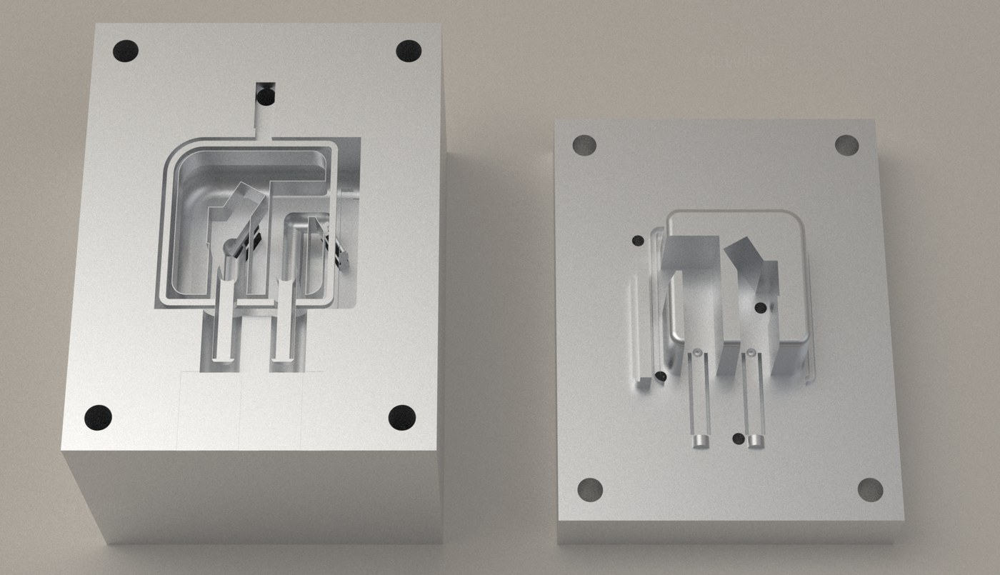 | 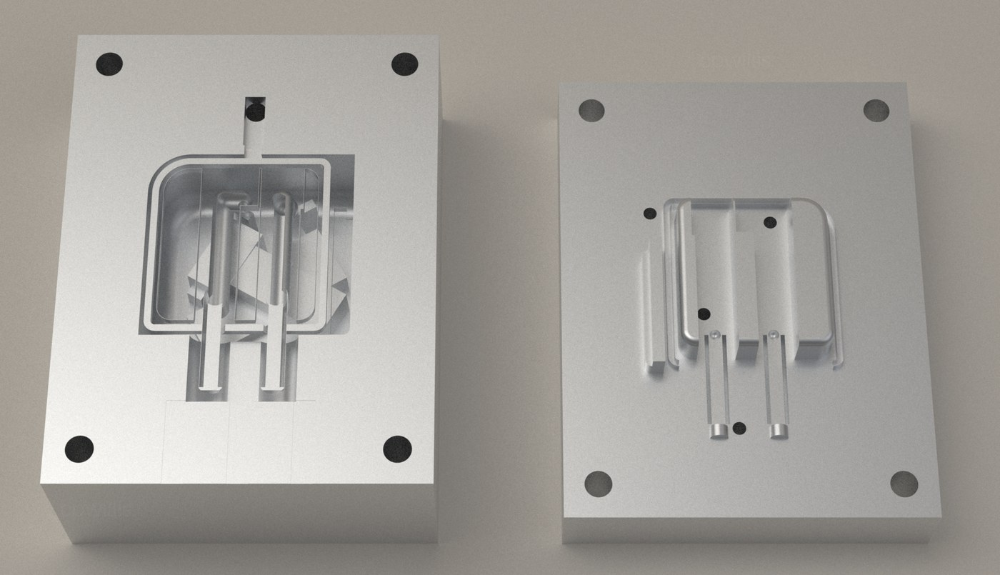 |
| Drawings | [FH-0001 top](docs/drawings/FH-0001_d1_housing_top.svg) · [FH-0002 bottom](docs/drawings/FH-0002_d1_housing_bottom.svg) · [clearance](docs/electrical/d1_clearance_section.svg) | [FH-1001 top](docs/drawings/FH-1001_d2_housing_top.svg) · [FH-1002 bottom](docs/drawings/FH-1002_d2_housing_bottom.svg) · [FH-1003 carrier](docs/drawings/FH-1003_d2_pin_carrier_top_pin.svg) · [clearance](docs/electrical/d2_clearance_section.svg) |

## How It Works

- **Interface:** the removable plug on classic Apple bricks (MagSafe 1/2, USB-C up to 96W, 140W A2452) slides into a
  29.5 x 28.3 mm corner notch: a slot captures the brick's stud [15, 16] and a C7 boss (8.6 mm pitch [24-26]) mates the
  C8 inlet. Flathead keeps both and moves the AU pins to the large face. No public source dimensions the notch or stud:
  they are scaled from teardown photos [19, 20] and set by the first print. 140W A3607 connector out of scope [44].
- **Live path:** AU pin, brass link in an insulating tube, C7 contact. Two poles, no earth (Class II). In D2 each
  pin reaches its link through a rotary contact break (below) and an insulated lead.
- **Housing:** two 2.2 mm shells split through the C7 and stud axes, welded on a tongue-and-groove joint with an
  energy director; lead frame insert moulded in the top shell.
- **D2 fold:** a single shared axle cannot fold 17 mm AU pins inside a 28 mm notch while keeping 9 mm edge
  clearance and clearing the switch. So each pin hinges on its own trunnions and folds flat inward; the active pin
  folds first into a deeper channel, the neutral folds over it (one-sided hinge, so the active tip passes its free
  end). Folded pins sit below the face, 2 mm inside the outline.
- **D2 contact break:** a strap in each carrier joins the blade to a metal core in its trunnion; past the trunnion end
  an arm on the core rests on a sprung pad in the slot floor only while the pin is open. Folding swings the arm off
  the pad within 10 deg, and folded it clears the pad by 3.05 mm (reinforced clearance). So a folded pin is dead even
  with the other pin pushed into a live socket, where the brick would otherwise back-feed it.
- **Fit:** pins 16.5 mm below the brick top edge. The brick extends room-right, so it fits the right socket of a
  double outlet (adjacent socket and both switches clear) or the right-end socket of a power board.

## Shared Stages

**Assembly and Packaging.** A printed weld nest holds the bottom shell for ultrasonic welding (0.15 mm clearance,
joint 1.5 mm above the nest, C7 boss relief); it fits both designs. The demo box is a reverse tuck end carton sized
from the part (inside 31.5 x 40.3 x 47.6 mm), a 1:1 dieline for A4 card with a card cradle for the plug.

| Weld Nest | Boxed Unit | Dieline |
|---|---|---|
| 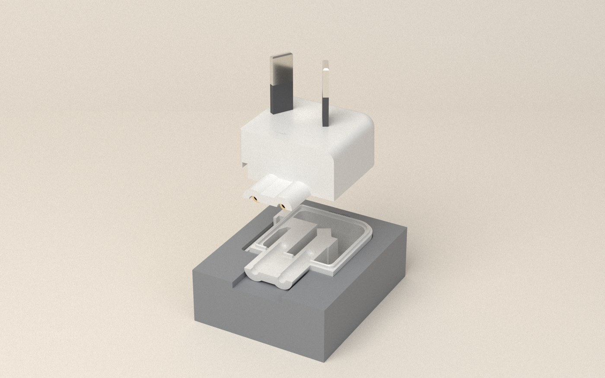 | 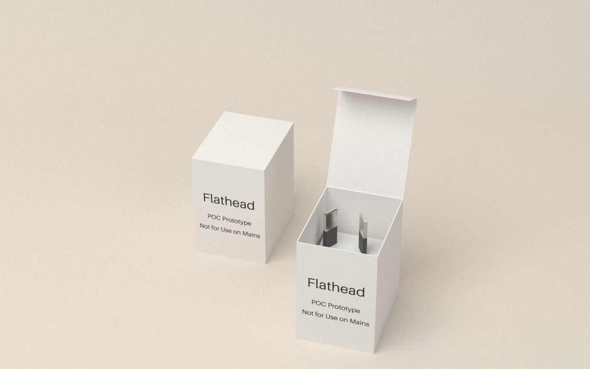 | 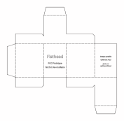 |

## Standards (Australia)

What a product would need to meet. This POC claims compliance with none of it. Not legal advice;
[n] is a source, listed at the end.

| Area | Position |
|---|---|
| Plug standard | AS/NZS 3112 Appendix J (plug portions of direct plug-in equipment). 2025 edition published 21 Nov 2025, applies from 21 Nov 2027 [7]. Values from the 2017+A1 test report form [2]. |
| Folding pins | 2025 cl 2.13.9.1: pins fixed in position [7]; EESS already rejects foldable integral pins [3]. D2 is a concept. |
| Classification | Classic duckhead: Type A detachable plug portion. A separately certified A/B device "cannot be sold as a separate part" [1]. **Standalone sale needs a regulator ruling first**. |
| Apple bricks | Level 3 with their own plug portions, eg 140W A2452 EESS-230105; 61W A1947 "appliance inlet only" [4]. |
| Marking | RCM per AS/NZS 4417, applied by a registered Responsible Supplier [5]. Prototypes carry none. |
| Materials | Ball pressure 125 C for parts supporting live parts, 75 C external; glow-wire 750 C [2, J4.8.4]. Makrolon 6555: ball pressure 136 C, GWFI 960 C at 1.5 mm, CTI 225 [11]. |
| Clearance | Reinforced, 250 V, OVC II (2.5 kV, reinforced 4 kV), PD2, group IIIa: clearance >= 3.0 mm, creepage >= 5.0 mm, basic creepage 2.5 mm [8]; solid insulation >= 2.0 mm reinforced, >= 1.0 mm supplementary, thinner by electric strength test (60335-1 cl 29.3) [9]. |
| Test finger | J4.8.1: small finger, IEC 61032 Figure 13, 20 N [2] = probe 19, 5.6 x 44 mm [10]. |
| Consumer law | ACL s131: report a death or serious injury within 2 days [13]. Qld "sell" includes offer and expose for sale [12]: demos unpriced, no orders. |
| Trade marks | Word marks only ("compatible with"), no logo, not in the product name, not-affiliated notice [14]. |

<details><summary>AS/NZS 3112 Appendix J Values Used [2]</summary>

| Clause | Requirement |
|---|---|
| 2.8.1 | Pins 6.35 +/-0.15 x 1.63 +0.15/-0.05 mm, length 17.06 +/-0.4 mm; live pin >= 9 mm from moulding edge; face proud <= 0.5 mm; outline <= 21.9 or >= 27.0 mm each way |
| 2.2.4 | Insulating sleeve 8.7 +/-0.5 mm; not green or green/yellow; no live metal exposed part-engaged |
| 2.12.6 | Viewed from the pins: earth, neutral, active clockwise |
| 2.13.3 | Electric strength 1000 V pole to pole, 3500 V to metal/electrode, 1250 V to sleeve foil |
| 2.13.9 | Pin movement 18 N at 14 mm, <= 2.0 mm (40 C); fixing 60 N 10 min, <= 2.4 mm (50 C) |
| 2.13.13 | Sleeve: 160 C pressure, damp heat, -15 C impact, 20,000-cycle abrasion |
| J4.3 | Tumbling barrel 500 mm onto steel; impact 1.0 J |
| J4.4 | Temperature rise <= 45 K at pins and contacts |
| J4.7 | Torque on socket <= 0.25 Nm |
| J4.8 | Test finger at 20 N; two-sided or spring contacts, no plastic contact pressure; 50 cycles then 60 N x3; ball pressure and glow-wire |

</details>

## Engineering

**Checks in Code.** Every build asserts the requirements it can: pin layout and polarity, edge clearance, face proud,
outline band, outlet fit, socket torque from each brick's mass and thickness [19-23] (worst 0.05 Nm, MagSafe2 85W),
partial engagement, clearance >= 3.0 mm (pole to pole D1 7.00, D2 4.50 mm), protrusion (28.5 to 29 mm), D2 fold sweep
every 15 deg through the whole sequence (no pin cuts a shell or the other pin), folded pins below the face and inside
the outline, D2 contacts break on folding and clear by >= 3.0 mm, shell joint >= 0.5 mm from the stud slot, attribution
marks present. Key checks (fit, clearance, solid insulation, D2 contact break) have negative tests that prove they fail
on a bad input. These are design screens, not type tests.

**Insulation Near the Stud Slot.** The notch width holds the neutral pin about 4 mm from the stud slot; the
straight-line screen (a lower bound on creepage) flags paths under the 5.0 mm creepage target.
- D1: each link runs in a PTFE tube (supplementary insulation, 0.8 mm wall, so qualified by electric strength [9])
  and joins its pin tail at the end away from the slot. Outside the tube only basic insulation is needed: tube to slot
  3.16 mm >= 2.5 basic (asserted). Wire to slot 3.96 mm, 3.10 mm of it through plastic (>= 2.0 DTI, asserted).
- D2: the small finger (5.6 mm [10]) enters both fold channels to the floor and narrower slots only to its tip's
  depth. Links and leads clear every reachable surface by 3.67 mm or more (>= 3.0 asserted), sleeves by 2.96 mm or
  more (basic 2.5 asserted); the A lead and both links are flagged under 5.0 mm creepage for the surface-path check.
  Contact arms and pads, like the C7 contacts, are judged by the test finger (REQ-ELE-004).
- D1 pin tails and D2 carrier roots are insert moulded as in any AU plug; electric strength tests (2.13.3) cover them.

**Design for Manufacture (D1 and D2).** 2.2 mm walls, columns round every insert (1.2 mm plastic), draft
0.5 deg on mating walls and 1 deg elsewhere as ruled primitives, 3.0 mm outer rounds and 1.0 mm inside rounds, round
wire links so core-formed pockets need no draft; D2's fold pockets widen toward the face so the cavity half draws them,
cut into an 8.7 mm solid deck under the pin face (no pocket columns, so no slivers where columns meet drafted walls).
Ray-cast DFM: 0 undrafted faces, 0 undercuts on all four shells. 0.7 % shrink [11], 2.5 x 1.2 mm edge gate, vents,
auto-placed ejectors, 8.3 to 9.5 cm3 shots (16 cm3 benchtop press); insert-formed faces need no core steel.

<details><summary>Requirements (38): Status and Evidence</summary>

| ID | Requirement | Method | Status | Evidence |
|---|---|---|---|---|
| REQ-FIT-001 | Clicks onto every classic-family brick, retention equal to stock duckhead | T | open | first print on a brick, stage 4 |
| REQ-FIT-002 | Fits AU double GPOs and power boards; adjacent socket usable, switch reachable | D | CAD check passing | fit.check_fit, margins +0.5 (double GPO) / +4.9 mm (board); socket pitch ASSUMED on GPOs [27-29], 45 mm on boards [30] |
| REQ-FIT-003 | Brick sits flat on wall; cord leaves the brick's side edge, clear of the outlet | D | by design | port on the side face opposite the head; confirm stage 4 |
| REQ-USR-001 | Wall protrusion <= brick thickness + 5 mm (target) | I | CAD check passing | fit.check_usr, 28.5 to 29.0 mm |
| REQ-DIM-001 | Pin width 6.35 +/-0.15 mm | I | design value | interface.Params pin_w; inspect stage 8/11 |
| REQ-DIM-002 | Pin thickness 1.63 +0.15/-0.05 mm | I | design value | interface.Params pin_th; inspect stage 8/11 |
| REQ-DIM-003 | Active/neutral pin length 17.06 +/-0.4 mm | I | CAD check passing | interface.check_common pin length |
| REQ-DIM-004 | Pin insulation sleeve 8.7 +/-0.5 mm | I | CAD check passing | interface.check_partial_engagement sleeve >= 8.2 |
| REQ-DIM-005 | Pin disposition passes Appendix A gauge (Fig 2.1: 7.92 mm from midpoint, radials 60 deg [6]) | I | open | printed Appendix A gauge, stage 11 |
| REQ-DIM-006 | Live pin to edge of moulding >= 9 mm | I | CAD check passing | interface.check_common, 9.05 mm (outer edges; brick-side faces mate the brick) |
| REQ-DIM-007 | No point on plug face protrudes > 0.5 mm | I | CAD check passing | interface.check_common, 0 mm proud |
| REQ-DIM-008 | Plug outline per Fig 2.1(a1): projection each direction <= 21.9 or >= 27.0 mm | I | CAD check passing | fit.check_fit outline band |
| REQ-DIM-009 | Pin ends have lead-in profile per Fig 2.1(h), (i) or (j) | I | design value | 0.4 mm tip chamfer approximates Fig 2.1(h) |
| REQ-DIM-010 | Pin configuration, viewed from pins: neutral then active clockwise (cl 2.12.6) | I | CAD check passing | interface.check_common pin order |
| REQ-MEC-001 | Torque on socket <= 0.25 Nm with heaviest brick (J4.7) | A, T | CAD check passing | fit.check_fit from brick mass and thickness, worst 0.05 Nm |
| REQ-MEC-002 | Tumbling barrel: 500 mm onto 3 mm steel, 10 falls/min; 500 drops <= 250 g, else 250 (J4.3.1) | T | open | bench drop, stage 11 |
| REQ-MEC-003 | Impact 1.0 +/-0.05 J, 3 blows per point stressing enclosure joints (J4.3.2) | T | open | bench impact, stage 11 |
| REQ-MEC-004 | Pin movement: 18 N at 14 mm, 1 h at 40 C, deflection <= 2.0 mm (2.13.9.1) | T | open | bench, stage 11 |
| REQ-MEC-005 | Pin fixing: 60 N 10 min at 50 C, displacement <= 2.4 mm, returns within 0.8 mm (2.13.9.2) | T | open | bench, stage 11 |
| REQ-MEC-006 | Stays attached: 50 attach/detach cycles then 60 N x3 parallel to pins without separating (J4.8.3). Two-action release required for Type A only if outlet is parallel to pins; D1 outlet is perpendicular (analysis) | T | open | stud head captured in the slot; bench stage 11 |
| REQ-MEC-007 | Pin bending: pins not broken off, 3 samples (2.13.7.2) | T | open | bench, stage 11 |
| REQ-ELE-001 | Contacts per J4.8.2 (two-sided or spring-assisted, no thermoplastic contact pressure) | I | by design | C7 tube contacts; D2 sprung pads under the pin contact arms; inspect stage 5 |
| REQ-ELE-002 | Temperature rise at pins and contacts <= 45 K (J4.4) | T | parked | lab only |
| REQ-ELE-003 | Electric strength 1000 V pole-pole, 3500 V to external metal / electrode, 1250 V to pin-insulation foil (2.13.3) | T | parked | lab only |
| REQ-ELE-004 | No live part touchable by the small finger (IEC 61032 fig 13, 5.6 mm) at 20 N, attached or detached (J4.8.1) | A, T | CAD screen passing; test open | d2.channel_faces reach model; probe 19 replica, stage 11 |
| REQ-ELE-005 | Incorrect assembly onto the brick not possible (J4.8.1) | D | open | one-way T-slot, C7 keyed by the notch; demonstrate stage 4 |
| REQ-ELE-006 | Live parts not exposed when partly or fully engaged in socket (2.2.4, Fig 2.4) | I | CAD check passing | interface.check_partial_engagement |
| REQ-ELE-007 | Creepage >= 5.0 mm, clearance >= 3.0 mm live to accessible surface (reinforced, 250 V, PD2, group IIIa) [8] | A, I | clearance asserted; creepage open (stage 5) | electrical.check_electrical: D1 tube to slot 3.16 mm basic; D2 3.67 mm to finger reach, sleeves 2.96 mm basic; creepage flags for stage 5 |
| REQ-MAT-001 | Glow-wire 750 C capable material (datasheet) | A | by datasheet | Makrolon 6555 GWFI 960 C at 1.5 mm [11] |
| REQ-MAT-002 | Ball pressure 75 C external, 125 C parts supporting live parts (datasheet) | A | by datasheet | Makrolon 6555 136 C [11]; carrier Ultramid A3X2G5 252 C [35] |
| REQ-MAT-003 | Sleeve material suitable for 160 C pressure, damp heat, -15 C impact, abrasion (2.13.13) | A | open | sleeve source, stage 9 |
| REQ-MAT-004 | Pin insulation not green or green/yellow (2.2.4) | I | open | sleeve colour, stage 9 |
| REQ-MAT-005 | Exposed pin contact portion smooth metal, no coating other than the sleeve (2.2.3) | I | open | pin source, stage 9 |
| REQ-FLD-001 | D2: pins lock open; meets REQ-MEC-004 in the open position | T | open | bench, stage 11 |
| REQ-FLD-002 | D2: pins fold flush into the face, no part proud when folded, no interference through the fold | I | CAD check passing | d2.check: sweep every 15 deg, folded 0.08 mm below the face, 1.97 mm inside the outline |
| REQ-FLD-003 | D2: fold/unfold cycle life >= 1,000 with no loss of lock or contact (target) | T | open | bench fold life, stage 11 |
| REQ-FLD-004 | D2: electrical path made only when a pin is open; a folded pin is disconnected | D | CAD check passing | d2.check: arm on pad when open, off within 10 deg, 3.05 mm clear when folded |
| REQ-FLD-005 | D2: open pins pass REQ-DIM-001..010 and the Appendix A gauge | I | CAD check passing | interface.check_common on D2 open |

</details>

<details><summary>Risk Register (DFMEA, AIAG-VDA Style; O and D Are Estimates)</summary>

| ID | Failure Mode | Effect | S | O | D | AP | Control | Status |
|---|---|---|---|---|---|---|---|---|
| F-01 | Live part reachable when detached or part-engaged | Shock | 10 | 2 | 3 | H | check_partial_engagement; test finger | CAD control in place |
| F-02 | Plug slides off brick while in socket | Arcing or fire | 10 | 4 | 5 | H | stud head captured in the slot; first-print fit; MEC-006 test | open |
| F-03 | Pin loosens or rotates in housing | Overheat or exposed metal | 9 | 2 | 4 | H | two grip grooves per tail face (insert moulded); 2.13.9 tests | CAD control in place |
| F-04 | Pins fold under load in socket | Arcing | 9 | 4 | 4 | H | open lock not yet designed (roadmap); FLD-001 test | open |
| F-05 | Contact pressure relaxes | Overheat at contact | 9 | 3 | 6 | H | standard C7 contacts; D2 sprung pads (contact pressure from the pad, not plastic) | open |
| F-06 | Heat or fire property fails | Fire | 9 | 2 | 3 | H | FR PC with GWFI 960 C and ball pressure 136 C [11] | datasheet control |
| F-07 | Shell cracks on drop | Exposed live parts | 9 | 3 | 4 | H | 2.2 mm walls; columns; drop test | open |
| F-08 | Live metal too close to accessible surface | Shock | 10 | 2 | 2 | H | D1 links in PTFE tube, 3.16 mm basic outside it; D2 clearance (3.67 mm to the 5.6 mm finger) and sleeves asserted; D2 creepage paths flagged | partly in place: creepage open |
| F-09 | D2 live lead near the fold pockets | Shock | 10 | 2 | 3 | H | PTFE lead to the pad underside; 3.67 mm to finger reach; under-pin joint lowered to clear the channel floor | CAD control in place |
| F-10 | Sink marks over thick columns and the D2 deck | Cosmetic; dimensional | 4 | 6 | 3 | M | 1.2 mm rib walls; deck coring or pack pressure TBD | open |
| F-11 | Parts stick on zero-draft walls | Damaged parts or tool | 6 | 2 | 2 | M | draft.py tapered primitives; dfm.py asserts no undrafted faces | CAD control in place |
| F-12 | Insert to cavity mismatch from shrink | Flash or insert stress | 5 | 5 | 4 | M | ~0.2 mm allowance | open |
| F-13 | Brick covers a switch on real outlets | Usability | 3 | 5 | 3 | L | fit.check_fit 0.5 mm margin | open |
| F-14 | Notch or stud geometry wrong (photo-scaled, no public dims) | Poor fit | 6 | 7 | 2 | H | teardown photo scaling [19, 20]; first print on a real brick, adjust | open |
| F-15 | Thin wall between shell joint groove and stud slot | Short shot or crack | 4 | 2 | 2 | L | stud head captured in the slot; groove 0.60 mm from slot, d1.check_housing asserts >= 0.5 | closed |
| F-16 | D2 neutral pin on a one-sided hinge | Pin loosens or tilts | 7 | 4 | 4 | H | 3 mm trunnion into the body; MEC-004/005 tests at stage 11 | open |
| F-17 | D2: one pin open in a live socket, the other folded | Folded pin back-fed through the brick, exposed in its channel | 10 | 3 | 5 | H | rotary contact break: arm off its pad within 10 deg, 3.05 mm clear folded; d2.check asserts it | CAD control in place |

</details>

<details><summary>Bill of Materials</summary>

| Part | Description | Material and source | Make | D1 | D2 |
|---|---|---|---|---|---|
| FH-0001 | D1 housing top shell | FR PC, Makrolon 6555 [11]; ABS for fit shots | moulded in-house (cad/mould.py) | 1 | 0 |
| FH-0002 | D1 housing bottom shell | FR PC, Makrolon 6555 [11]; ABS for fit shots | moulded in-house (cad/mould.py) | 1 | 0 |
| FH-0010 | AU flat pin with insulating sleeve | Ni-plated brass, sleeve not green or green/yellow; from an AU rewireable plug, eg Clipsal 439S [36] | harvested | 2 | 2 |
| FH-0011 | C7 spring contact | brass; from a rewireable C7 connector [45] | harvested | 2 | 2 |
| FH-0012 | Link | brass rod 1/16 in (1.57 mm), C260, K&S 8162 [33] | cut and bent in-house | 2 | 2 |
| FH-0013 | Link tube, 1.6 x 3.2 mm | PTFE, -200 to +260 C, Bohlender b.safe R 750-08 [31] | cut to length | 2 | 2 |
| FH-1001 | D2 housing top shell | FR PC, Makrolon 6555 [11] | moulded in-house (cad/mould.py) | 0 | 1 |
| FH-1002 | D2 housing bottom shell | FR PC, Makrolon 6555 [11] | moulded in-house (cad/mould.py) | 0 | 1 |
| FH-1003 | D2 pin carrier with trunnions, moulded round the pin root | PA66-GF25 FR, BASF Ultramid A3X2G5: V-0 at 0.8 mm, GWFI 960 C, ball pressure 252 C, CTI 550 [35] | insert moulded; printed for POC | 0 | 2 |
| FH-1004 | D2 lead, link to contact pad | 22 AWG PTFE, 600 V, 200 C, OD 1.27 mm, Alpha Wire 5855/7 [32] | cut and crimped | 0 | 2 |
| FH-1005 | D2 contact arm: strap, trunnion core and arm, moulded into the carrier | phosphor bronze C51000, spring temper [34] | stamped and formed | 0 | 2 |
| FH-1006 | D2 contact pad, sprung | phosphor bronze C51000 0.32 mm strip, Continental Steel CPB-0126-28 [34] | stamped, insert moulded | 0 | 2 |
| FH-9001 | Demo box (cad/box.py) | 0.4 mm card, printed dieline | cut and folded in-house | 1 | 1 |
| FH-9101 | Weld nest (cad/jig.py) | resin or PC print | printed in-house | 1 | 1 |

</details>

## Delivery Process

End to end, reusable for any small moulded electrical accessory. POC column is this repo; production column is the
business version.

| # | Stage | POC (In-House) | Production | Output | Gate |
|---|-------|----------------|------------|--------|------|
| 1 | Requirements | IDs, methods, standards | + cost target, price | Requirements matrix | Review |
| 2 | Research | Patents, teardowns, certificates, datasheets | Supplier samples | Interface reference, BOM | |
| 3 | Part CAD | build123d, checks in code, drawings | Same, DFM by toolmaker | STEP, drawings | Design review |
| 4 | Prototypes | Resin prints fitted on a brick | Appearance models | Locked fit params | Proto |
| 5 | Electrical | Lead frame, clearance screen | Lab-ready design | Sections | EVT |
| 6 | Mould design | `cad/mould.py`, DFM report | Toolmaker design, mouldflow | Core/cavity STEP | Tool release |
| 7 | Mould making | Resin inserts, then CNC aluminium | P20/H13 steel tool | Tools | |
| 8 | Moulding | Benchtop press, process sheet | Contract moulder, locked process | T1 parts | DVT |
| 9 | Components | Harvested pins, cut links | Stamped parts, MOQs | BOM | |
| 10 | Assembly | Hand jig, ultrasonic weld | Jigs, weld cell | Units | |
| 11 | Test | Bench tests, first article, sample-size rationale | Lab type tests, 100 % line test | Reports | PVT |
| 12 | Certification | Parked | Regulator ruling, CoC, RCM | Certificate | Launch |
| 13 | Packaging | Demo box, "not for mains" | Retail pack, ARL, GS1 | Boxed unit | |
| 14 | End user | Unpowered outlet demo, feedback | Sale, warranty, field feedback | Feedback | Retro |

## Business Notes

| Item | Ballpark |
|---|---|
| POC spend | Estimate: A$1.5 to 3.5k with a bureau or makerspace; A$6 to 10k with an own benchtop press. |
| POC time | Estimate: 4 to 7 months part-time. |
| Tooling | Aluminium tools from US$1,500 [37]; P20 steel US$12 to 60k for a moderate consumer part [38]. Own the tooling title in writing. |
| Certification | Certifier and lab, estimate A$2.5 to 6.5k, 4 to 10 weeks. EESS Responsible Supplier A$239.74/yr, Level 3 item A$89.85 (1 yr) to A$449.25 (5 yr) [5]. |
| Launch | Products liability A$360 to 1,800+/yr, indicative [40]; GS1 barcodes from A$79 [39]. |
| Import | GST 10 %; no duty or GST at the border up to A$1,000 [43]. |
| Funding | Industry Growth Program paused since May 2026 [41]; R&D Tax Incentive refundable offset = tax rate + 18.5 %, A$20k minimum [42]. |
| IP | Freedom to operate before sale: Apple design patents on adapter plugs, eg USD661649 [17]; Volex duckhead patent US8388352B1 lapsed Mar 2025 [18]. |

## Roadmap

Done in this POC: interface, pins, outlets, standards and BOM sourced; CAD, checks, tools, drawings, renders, box.
Left, needing hardware or a decision:

- [ ] Print, fit on a real brick, adjust any `ASSUMED` interface value (stage 4)
- [ ] Machine aluminium tools, mould ABS fit shots then FR PC (stages 7, 8)
- [ ] Assemble, weld, bench test, first article inspection (stages 10, 11)
- [ ] Print and fold the demo box; unpowered user demo (stages 13, 14)
- [ ] Left-hand variant (brick extends room-left)
- [ ] D2: open lock for the pins, carrier tooling, fold-life test (stages 4, 11)
- [ ] Before any sale: regulator ruling, freedom to operate
- [ ] Trade mark search for "Flathead"

## Development

```bash
uv sync --all-groups                             # CAD, dev (ruff, pytest), render (Mitsuba)
uv run python cad/d1.py                          # D1: build, checks, STEP/STL
uv run python cad/d2.py                          # D2: build, checks
uv run python cad/dfm.py                         # draft and undercut report
uv run python cad/mould.py                       # D1 and D2 tools, checks
uv run python cad/jig.py                         # weld nest STL, checks
uv run python cad/box.py                         # demo box dieline
uv run python cad/drawings.py                    # drawings, clearance sections
uv run python cad/renders.py                     # line art
uv run --group render python cad/photo.py        # photoreal renders (Apple GPU or CPU); SPP=32 for previews
uv run python cad/provenance.py                  # after regenerating docs/: SHA256SUMS, GPG-signed
uv run pytest                                    # every check and attribution mark, about 25 min
uv run ruff check && uv run ruff format --check  # lint and format check
```

Outputs land in `cad/out/` (gitignored). Conventions: millimetres; part frame has the plug face at `z = t`, wall side
`+z`, brick hangs down (`+y` up); every unsourced dimension is tagged `ASSUMED` in `Params`, sourced ones carry their
reference; checks are `assert`s named after requirement IDs; generated images and drawings are committed, CAD exports
are not.

```
cad/    interface, d1, d2, draft, electrical, fit, dfm, mould, jig, box, props, drawings, renders, photo, provenance
tests/  every check, negative cases for the key ones, attribution marks
docs/   drawings/, electrical/, images/
```

## Provenance and Licence

Open hardware, permissive: use, modify, fork, make and sell, provided the credit travels with it. Any product sold
needs its own certification and a regulator ruling (see Standards); prototypes must not be used on mains.
- **Design** (`cad/` CAD source, `docs/` drawings and renders, every CAD export):
  [CERN-OHL-P-2.0](LICENSE). Section 4: anyone who makes or conveys a product must give its recipient access to the
  [NOTICE](NOTICE), so the credit reaches buyers of physical units, not only users of the files.
- **Tooling** (`tests/`, CI, project config): [Apache-2.0](LICENSE-APACHE); section 4(d) keeps the NOTICE in
  derivative works.

Credit line: "Based on Flathead by cpwillis, https://github.com/cpwillis-pocs/flathead". The name "Flathead" is not
licensed. Source files carry SPDX licence headers.

The design carries its origin, so derived files and parts stay traceable (`cad/provenance.py`; tests fail if a mark
goes missing):

| Output | Attribution |
|---|---|
| Moulded and printed parts | Small "cpwillis" mould mark with draft (pin face, D1 inside floor, weld nest) and a "flathead" wordmark on the room face; the tool inherits both |
| STEP, STL | Author and rights in the file header |
| SVG drawings and line art | Mould mark as a faint hairline; title, description, RDF `dc:creator`/`dc:rights`, `cpwillis-` ids, ink colour fingerprint, 2 % hidden text |
| JPEG renders | EXIF artist, copyright and description; two hidden marks a high-pass filter recovers |
| Demo box | Credit and licence printed on the back panel |
| Published assets | `docs/SHA256SUMS`, detached GPG signature `docs/SHA256SUMS.asc`; signed commits |

```bash
cd docs && shasum -a 256 -c SHA256SUMS && gpg --verify SHA256SUMS.asc SHA256SUMS
```

Apple, MacBook and MagSafe are trademarks of Apple Inc. This project is not affiliated with or endorsed by Apple.
Other product names are trademarks of their respective owners.
The renders show generic chargers. Provided as is, with no warranty; prototypes are uncertified and must not be
used on mains.

<details><summary>Sources</summary>

1. EESS bulletin #20-001, Appendix J certification: https://www.eess.gov.au/wp-content/uploads/2020/05/20-001-Information-Bulletin-ASNZS3112-Appendix-J.pdf
2. EESS Appendix J test report form #20-019 (AS/NZS 3112:2017+A1:2021): https://www.eess.gov.au/wp-content/uploads/2022/08/20-19-General-Guidance-ASNZS3112_2017_A1_2021_App_J_TRF-v1.01.pdf
3. EESS bulletin #24-067, equipment with integral pins: https://eess.gov.au/wp-content/uploads/2024/07/24-067-Information-Bulletin-Equipment-with-integral-pins-v1.0.pdf
4. EESS public certificate search: https://eessplatform.eess.gov.au/prweb/PRAuth/Public
5. EESS registration fees (1 Jul 2026): https://www.eess.gov.au/registration/registration-fees/
6. AS/NZS 3112 (Figure 2.1 pin disposition: D 7.92, E 10.31, radials 60 deg): https://store.standards.org.au/product/as-nzs-3112-2025
7. UL AU/NZ compliance insights, Nov 2025 (AS/NZS 3112:2025): https://au-nz.ul.com/news/compliance-insights-november-2025
8. IEC 60664-1 ed3.1 preview (Tables F.1, F.2, F.5): https://assets.vde-verlag.de/iec-normen/preview-pdf/info_iec60664-1%7Bed3.1%7Den.pdf
9. IEC 60335-1 cl 29.3 as applied in a test report: https://www.victronenergy.com/upload/documents/Safety-EN-IEC-60335-1-Cyrix.pdf
10. IEC 61032 probes 18 (fig 12) and 19 (fig 13), supplier catalogue: https://www.suppliergo.com/provide/p172625131.html
11. Covestro Makrolon 6555: https://solutions.covestro.com/en/products/makrolon/makrolon-6555_56978651-00009624
12. Qld Electrical Safety Act 2002: https://www.legislation.qld.gov.au/view/whole/html/inforce/2026-03-27/act-2002-042
13. Product Safety Australia, mandatory reporting: https://www.productsafety.gov.au/business/make-a-mandatory-report/when-you-must-report-an-incident
14. Apple third-party trademark guidelines: https://www.apple.com/legal/intellectual-property/guidelinesfor3rdparties.html
15. Apple patent US8222773B2 (figure-eight connector, plug body notch): https://patents.google.com/patent/US8222773B2/en
16. Apple patent US7766698B1 (notch engages a housing protrusion): https://patents.google.com/patent/US7766698B1/en
17. Apple design patent USD661649 (power adapter, plug removed): https://patents.google.com/patent/USD661649
18. Volex patent US8388352B1 (duckhead, expired fee related 2025): https://patents.google.com/patent/US8388352B1/en
19. ChargerLAB 70W A2743 teardown (65 x 65 x 28.5 mm, 165 g): https://chargerlab.com/teardown-of-brand-new-apple-70w-gan-usb-c-power-adapter-a2743
20. ChargerLAB 140W A3607 teardown (95.68 x 74.35 x 28.51 mm, 285 g): https://www.chargerlab.com/teardown-of-apple-140w-usb-c-power-adapter-a3607
21. ChargerLAB 87W A1719 teardown (29/61/87W bricks 28 mm thick): https://www.chargerlab.com/apple-87w-usb-c-power-adapter-a1719-teardown-review-the-back-of-the-drawer
22. TidBITS forum (61W A1947 74 x 74 x 29 mm, 209 g): https://talk.tidbits.com/t/did-apple-stop-selling-a1947-usb-c-power-adapters/28661
23. MacRumors forum (96W 80 x 80 x 28.6 mm, 299 g): https://forums.macrumors.com/threads/67w-vs-96w-power-adapter-dimensions-which-is-overall-better.2339476/
24. Schurter 2578 C8 inlet (pitch 8.6 +/-0.1): https://www.schurter.com/en/datasheet/typ_2578.pdf
25. Wikipedia IEC 60320 (C8 inlet depth 10): https://en.wikipedia.org/wiki/IEC_60320
26. Schurter 4810 C7 cord set (moulded end 19.6 x 12): https://www.schurter.com/en/datasheet/typ_4810.pdf
27. Clipsal 2000 series 2025D (plate 116 x 76): https://clipsal.com/products/power-points-switches/2000-series/twin-switch-socket-outlet-250v-10a-2-pole-2025d
28. Clipsal Iconic 3025 datasheet (120 x 78): https://www.sparkydirect.com.au/assets/brochures/3025XAVW.pdf
29. Legrand HPM Excel XL777 (plate 73 x 117, centres 84): https://assets.legrand.com/pim/NP-FT-GT/DSH%20XL777.pdf
30. Jaycar MS4061 power board (sockets 45 mm apart): https://jaycar.co.nz/4-way-powerboard-with-4-switches-and-surge-overload-protection/p/MS4061
31. Bohlender PTFE tube 1.6 x 3.2 mm, R 750-08: https://www.labfriend.com.au/bohlender-bsafes-tubing-ptfe-16mm-x32mm-x-t-080mm
32. Alpha Wire 5855/7, 22 AWG PTFE (RS 177-1129): https://uk.rs-online.com/web/p/hookup-equipment-wire/1771129/
33. K&S 8162 brass rod 1/16 in, C260: https://www.walmart.com/ip/39658591
34. Continental Steel phosphor bronze C51000 strip: https://continentalsteel.com/compare/coils-and-angles/strip-coil-sheet-phosphor-bronze-uns-c51000-
35. BASF Ultramid A3X2G5 datasheet: https://download.basf.com/p1/8a8082587fd4b608017fd647ce083a48/en/ULTRAMID%C2%AE_A3X2G5
36. Clipsal 439S rewireable plug datasheet: https://assets.cef.co.uk/downloads/pdg/clipsal_439s-we_datasheet/clipsal_439s-we_datasheet.pdf
37. Protolabs, aluminium mould tooling: https://www.protolabs.com/resources/blog/aluminum-mold-tooling-for-injection-molding/
38. HLH, injection moulding cost: https://hlhrapid.com/blog/injection-molding-cost/
39. GS1 Australia: https://www.gs1au.org/why-choose-gs1
40. Upcover, product liability insurance: https://www.upcover.com/blog/product-liability-insurance-what-it-covers-and-who-needs-it
41. Industry Growth Program: https://www.industry.gov.au/science-technology-and-innovation/industry-innovation/industry-growth-program
42. ATO, R&D tax incentive offset rates: https://www.ato.gov.au/business/research-and-development-tax-incentive/rates-of-r-d-tax-incentive-offset
43. ABF low value threshold: https://www.abf.gov.au/help-and-support-subsite/CustomsNotices/2018-13.pdf
44. MacRumors, 140W connector change (Apr 2026): https://www.macrumors.com/2026/04/02/apple-140w-power-adapter-compatibility-issue/
45. IEC 60320 C7 rewireable connector (brass contacts): https://www.designacable.com/iec-c7-figure-8-rewireable-female-plug-kettle-connector-cable-mount-black.html

</details>
